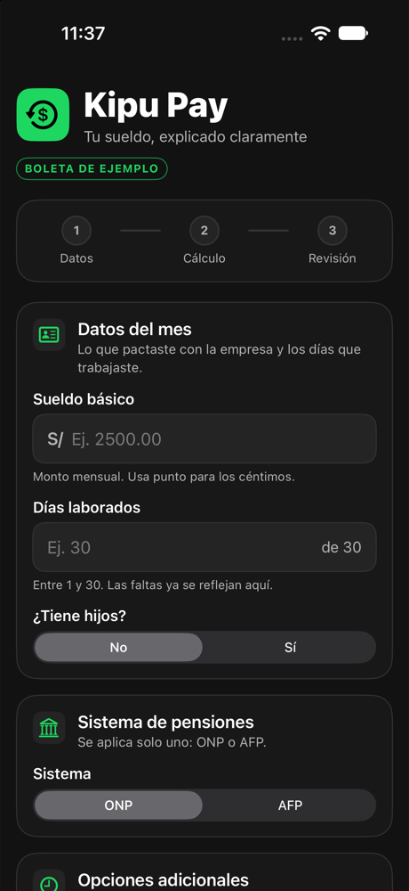
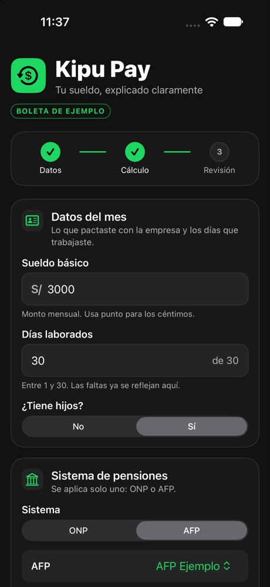
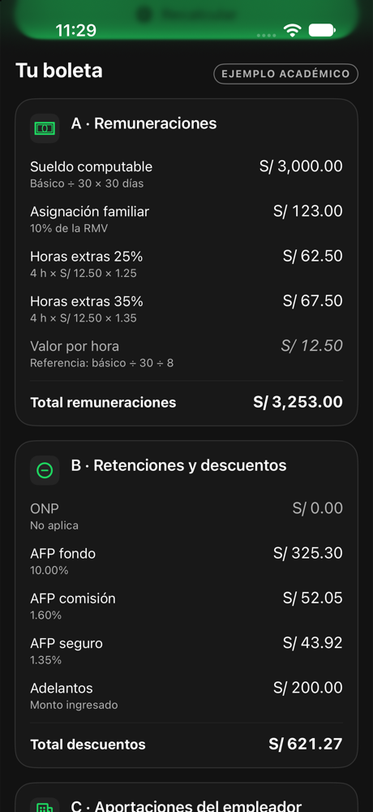
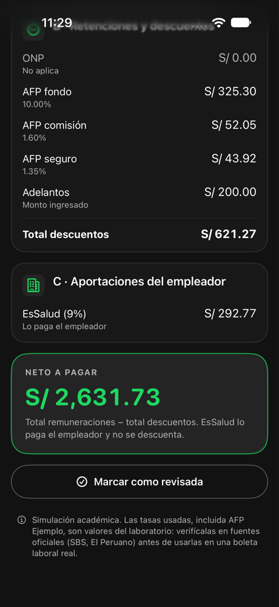
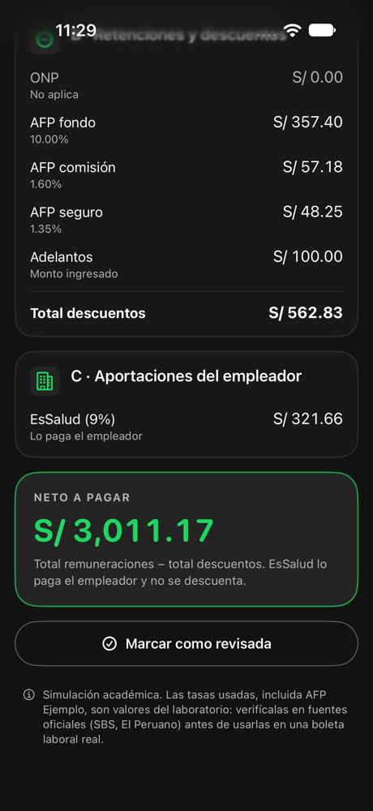
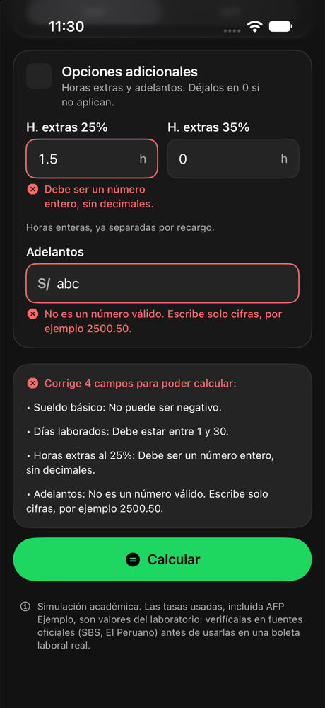
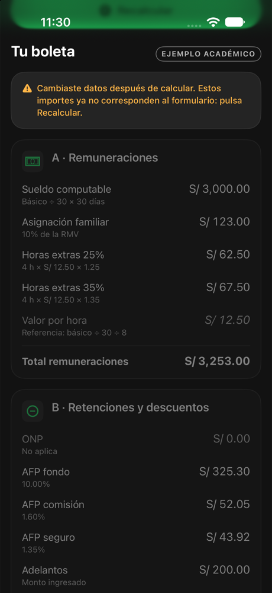
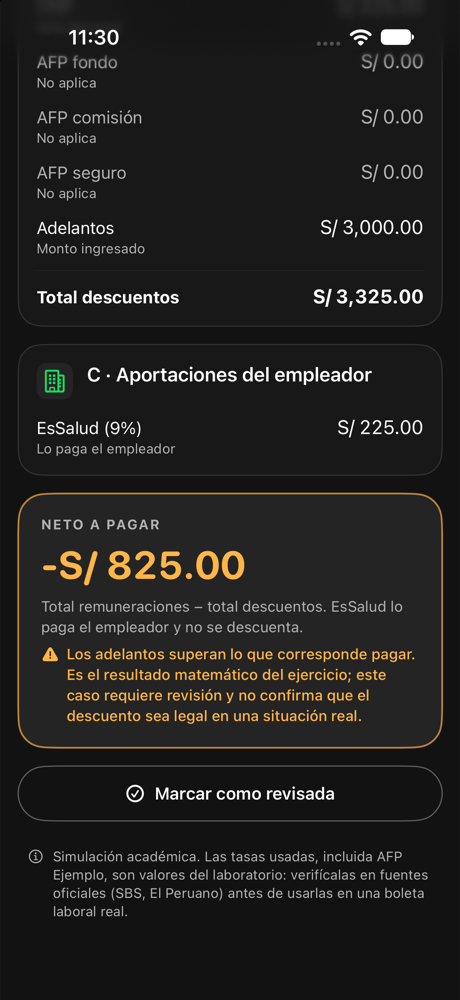

# Kipu Pay — Boleta de pago (SwiftUI)

> ⚠️ **Simulación académica.** Esta app calcula una boleta de pago **de ejemplo** con las reglas
> simplificadas de la actividad *Actividad_Grupo_B* ("Boleta de pago: del sueldo al neto").
> Las tasas de AFP son las publicadas por la SBS para el devengue de octubre de 2026 y la RMV es
> la del D.S. 015-2026-TR. Estos valores cambian con el tiempo: verifícalos antes de usarlos en una
> boleta laboral real.

Kipu Pay es una app iOS de **una sola pantalla**: arriba el formulario con los datos del mes y,
al pulsar **Calcular**, la boleta debajo con sus tres bloques (Remuneraciones, Retenciones y
descuentos, Aportaciones del empleador) y el **neto a pagar** destacado.

## Funcionalidades

- Formulario con validación: sueldo básico, días laborados, hijos (No/Sí), sistema de pensiones (ONP/AFP).
- Nivel 2: selector de AFP (solo visible con AFP) con las 4 AFP reales en modalidad de comisión
  por flujo o mixta, horas extras al 25% y al 35%, adelantos.
- Boleta en tres bloques; los conceptos que no aplican se muestran con S/ 0.00.
- Importes en soles con formato `es_PE` (`S/ 2,175.00`), alineados a la derecha.
- Progreso en tres etapas que refleja el estado real: **Datos** (formulario válido),
  **Cálculo** (boleta vigente) y **Revisión** (el usuario pulsó "Marcar como revisada").
- Si se cambia un dato después de calcular, la boleta se atenúa y se marca como desactualizada
  hasta pulsar **Recalcular**; el progreso de cálculo y revisión vuelve a pendiente.
- Neto negativo (adelanto mayor que lo que corresponde pagar): se muestra el resultado
  matemático con un aviso de que el caso requiere revisión.
- Tema oscuro con paleta propia (`#121212`, `#181818`, `#242424`, verde `#1ED760`/`#1DB954`),
  SF Symbols, animaciones breves, vibración al calcular o al fallar la validación.
- Accesibilidad: errores con icono y texto (no solo color), etiquetas de VoiceOver en campos e
  importes, tipografía dinámica del sistema, objetivos táctiles ≥ 48 pt.
- Teclado: barra con *Anterior / Siguiente / Listo*, cierre interactivo al desplazar y
  desplazamiento automático al campo activo.

## Reglas de cálculo

Todas las tasas viven en `Constants/ParametrosLaborales.swift`; las fórmulas en `Models/Boleta.swift`.
**Cada concepto se redondea a 2 decimales (mitad hacia arriba, como `REDONDEAR` de Excel) antes de sumarlo.**
Los cálculos usan `Decimal`, nunca `Double`.

| Concepto | Fórmula |
|---|---|
| Sueldo computable | Sueldo básico ÷ 30 × días laborados |
| Asignación familiar | 10% de la RMV (S/ 123.00) si tiene hijos; no se prorratea |
| Valor por hora | Sueldo básico ÷ 30 ÷ 8 |
| Horas extras 25% | Valor hora × 1.25 × horas al 25% |
| Horas extras 35% | Valor hora × 1.35 × horas al 35% |
| Total remuneraciones | Suma de los cuatro conceptos anteriores |
| ONP | Total remuneraciones × 13% (solo si es ONP) |
| AFP fondo / comisión | Total remuneraciones × tasa de la AFP, cada uno redondeado (solo si es AFP) |
| AFP seguro | Mínimo entre el total de remuneraciones y la remuneración máxima asegurable (S/ 12,732.70) × 1.37% |
| Adelantos | Monto ingresado, se resta tal cual |
| Total descuentos | Pensión (ONP **o** AFP) + adelantos |
| Neto a pagar | Total remuneraciones − total descuentos |
| EsSalud (empleador) | Total remuneraciones × 9%. **No se descuenta** al trabajador |

No se calcula renta de 5.ª categoría (es parte del nivel 3, opcional).

### Decisiones de redondeo (para que coincida con Excel)

1. **Valor por hora redondeado.** El valor hora se redondea a 2 decimales (es un concepto de la
   tabla de reglas y el caso 3 lo muestra como 12.50) y las horas extras se calculan con ese valor.
   En Excel: `=REDONDEAR(Básico/30/8; 2)` en su propia celda, y las horas extras referencian esa celda.
   Ejemplo: sueldo 2,500 y 1 hora al 25% → 10.42 × 1.25 = 13.025 → **13.03**
   (sin redondear el valor hora saldría 13.02).
2. **Discrepancia encontrada y corregida.** Con `Decimal`, `2500.55 ÷ 30 × 15` daba
   `1250.2749999…` (el cociente periódico se trunca a 38 dígitos) → **1250.27**, mientras que el
   valor exacto —y el de Excel— es 1250.275 → **1250.28**. Se corrigió calculando
   `básico × días ÷ 30` y `básico ÷ 240`: es la misma fórmula, con la división al final, y el
   resultado es exacto. Hay una prueba de regresión (`sueldoConCentimos`).

## Parámetros y fuentes

| Parámetro | Valor | Fuente | Fecha de consulta |
|---|---|---|---|
| RMV | S/ 1,230.00 | D.S. 015-2026-TR, vigente desde el 01/10/2026 | 28/10/2026 |
| Asignación familiar | 10% de la RMV = S/ 123.00 | Ley 25129 | 28/10/2026 |
| ONP | 13% | D.L. 19990 | 28/10/2026 |
| EsSalud | 9% | Ley 26790 | 28/10/2026 |
| Horas extras | ×1.25 y ×1.35 | Normas de jornada y sobretiempo | 28/10/2026 |
| Aporte al fondo AFP | 10% (todas las AFP) | SBS, comisiones y primas del SPP, devengue 10/2026 | 28/10/2026 |
| Prima de seguro AFP | 1.37% (todas las AFP, Ley 32123) | SBS, devengue 10/2026 | 28/10/2026 |
| Remuneración máxima asegurable | S/ 12,732.70 (oct–dic 2026) | SBS, devengue 10/2026 | 28/10/2026 |

**Comisión de cada AFP** (SBS, devengue octubre 2026, consultado el 28/10/2026):

| AFP | Comisión por flujo (sobre la remuneración) | Comisión mixta: sobre la remuneración | Comisión mixta: anual sobre el saldo* |
|---|---:|---:|---:|
| Habitat | 1.47% | 0.00% | 1.25% |
| Integra | 1.55% | 0.00% | 0.78% |
| Prima | 1.60% | 0.00% | 1.25% |
| Profuturo | 1.69% | 0.00% | 0.68% |

\* La comisión sobre el saldo se cobra del fondo acumulado y **no aparece en la boleta**; por eso, en la
modalidad mixta, la comisión de la boleta es S/ 0.00. Desde 2013 los nuevos afiliados entran en la
modalidad mixta; los afiliados más antiguos pueden seguir en flujo. El selector ofrece ambas.

Fuentes: [SBS – Comisiones y primas de seguros](https://www.sbs.gob.pe/app/spp/empleadores/comisiones_spp/paginas/comision_prima.aspx),
[D.S. 015-2026-TR (LP Derecho)](https://lpderecho.pe/keiko-fujimori-firma-decreto-supremo-aumento-sueldo-minimo/).
Las tasas de AFP se actualizan cada mes; la remuneración máxima asegurable, cada trimestre.

**AFP Ejemplo** (fondo 10%, comisión 1.60%, seguro 1.35%) se conserva al final del selector solo para
reproducir los casos 3 y 4 del enunciado, que el docente revisa con esas tasas. No es una AFP real.

Para actualizar las tasas, edita el diccionario `tasasAFP` en `ParametrosLaborales.swift`; el
selector se actualiza solo. Si una AFP no tiene tasas, el cálculo se bloquea (nunca se usa 0).

## Requisitos de programación del documento

| Requisito | Dónde |
|---|---|
| `struct` con los datos del trabajador | `DatosTrabajador` (`Models/DatosTrabajador.swift`) |
| Clase `Boleta` que calcula | `final class Boleta` (`Models/Boleta.swift`) |
| Diccionario con las tasas de cada AFP | `ParametrosLaborales.tasasAFP: [String: TasasAFP]` |
| Array con los conceptos | `Boleta.conceptos: [ConceptoBoleta]`; los totales se obtienen sumando este array y la vista lo recorre |
| Separación interfaz / cálculo | Las vistas solo leen `Boleta`; ninguna fórmula está en la UI |
| Constantes centralizadas | `Constants/ParametrosLaborales.swift` |
| Controles | `Text`, `VStack`, `HStack`, `@State`, `TextField`, `Picker`, `Button`, `ScrollView` |

## Estructura

```
Kipu Pay/
├── Kipu_PayApp.swift                 Punto de entrada (@main), fuerza modo oscuro
├── ContentView.swift                 Pantalla única: encabezado, progreso, formulario, botón, boleta
├── Constants/ParametrosLaborales.swift  RMV, tasas, diccionario de AFP, límites de validación
├── Models/
│   ├── DatosTrabajador.swift         struct con los datos validados + enum SistemaPensiones
│   └── Boleta.swift                  clase Boleta, ConceptoBoleta, ErrorBoleta
├── Services/
│   ├── Moneda.swift                  Redondeo a 2 decimales y formato es_PE
│   └── ValidadorEntrada.swift        Texto → número, con mensajes de error
├── ViewModels/BoletaViewModel.swift  Estado del formulario, validación, recalcular, progreso
└── Views/
    ├── ComponentesUI.swift           Paleta, tarjetas, campos, botones, progreso
    ├── FormularioTrabajadorView.swift
    └── BoletaResultadoView.swift
Kipu PayTests/                        Pruebas unitarias (Swift Testing)
docs/capturas/                        Capturas del simulador
excel/Kipu_Pay_Boleta.xlsx            Libro de Excel con las fórmulas (control cruzado)
```

## Validaciones

| Entrada | Comportamiento |
|---|---|
| Sueldo vacío, 0, negativo | "Este campo es obligatorio." / "Debe ser mayor que cero." / "No puede ser negativo." |
| Días vacíos, 0, 31, decimales (`27.5`) | Obligatorio / "Debe estar entre 1 y 30." / "Debe ser un número entero, sin decimales." |
| Horas extras negativas o decimales | Error; vacío = 0 |
| Adelanto negativo o texto | Error; vacío = 0 |
| Espacios al inicio/fin | Se ignoran (`"  3000 "` → 3000) |
| Separador decimal `.` o `,` | Ambos se aceptan con hasta 2 decimales (`2500,50` = 2500.50) |
| Separador de miles (`2,500`, `2,500.00`) | Se rechaza con mensaje: así `2,500` nunca se interpreta como 2.5 |
| Texto no numérico (`abc`, `1e5`) | "No es un número válido…" |
| Montos > S/ 10,000,000.00, horas > 720 | Se rechazan (límites en `ParametrosLaborales`) |

Una entrada inválida **nunca se convierte en cero**: el cálculo se bloquea y se listan los
campos a corregir. Los errores aparecen tras el primer intento de cálculo y se actualizan en vivo.

## Casos de prueba

### Casos oficiales (verificados en pruebas unitarias y en el simulador)

Los casos 3 y 4 usan **AFP Ejemplo**, como indica el enunciado (elígela al final del selector de AFP).

| Concepto | Caso 1 | Caso 2 | Caso 3 | Caso 4* |
|---|---:|---:|---:|---:|
| Entradas | 2,500 · 30 d · sin hijos · ONP | 1,800 · 27 d · con hijos · ONP | 3,000 · 30 d · con hijos · AFP · 4 h + 4 h · adelanto 200 | 4,200 · 24 d · con hijos · AFP · 2 h + 2 h · adelanto 100 |
| Sueldo computable | 2,500.00 | 1,620.00 | 3,000.00 | 3,360.00 |
| Asignación familiar | 0.00 | 123.00 | 123.00 | 123.00 |
| Valor hora | 10.42 | 7.50 | 12.50 | 17.50 |
| Horas extras 25% | 0.00 | 0.00 | 62.50 | 43.75 |
| Horas extras 35% | 0.00 | 0.00 | 67.50 | 47.25 |
| **Total remuneraciones** | **2,500.00** | **1,743.00** | **3,253.00** | **3,574.00** |
| ONP | 325.00 | 226.59 | 0.00 | 0.00 |
| AFP fondo | 0.00 | 0.00 | 325.30 | 357.40 |
| AFP comisión | 0.00 | 0.00 | 52.05 | 57.18 |
| AFP seguro | 0.00 | 0.00 | 43.92 | 48.25 |
| Adelantos | 0.00 | 0.00 | 200.00 | 100.00 |
| **Total descuentos** | **325.00** | **226.59** | **621.27** | **562.83** |
| **Neto a pagar** | **2,175.00** | **1,516.41** | **2,631.73** | **3,011.17** |
| EsSalud (empleador) | 225.00 | 156.87 | 292.77 | 321.66 |

\* El documento no publica la respuesta del caso 4. Los valores se obtuvieron con un cálculo
independiente (Python `decimal`, `ROUND_HALF_UP`, mismas reglas) y coinciden con la app.
La hoja de Excel (`excel/Kipu_Pay_Boleta.xlsx`) da los mismos valores al centavo.

### Pruebas adicionales

| # | Escenario | Resultado esperado | Prueba |
|---|---|---|---|
| 1 | Sueldo vacío | Error, no calcula | `sueldoVacioOCero`, `bloqueoPorErrores` |
| 2 | Sueldo 0 / negativo | Error, no calcula | `sueldoVacioOCero`, `montosInvalidos`, `sueldoInvalido` |
| 3 | Días 0, 1, 30, 31 | 1 y 30 válidos; 0 y 31 error | `diasValidos`, `diasInvalidos`, `diasLimite` |
| 4 | Días con decimales | "Debe ser un número entero" | `mensajeDecimales` |
| 5 | Sueldo con céntimos (2,500.55; 15 d) | Computable 1,250.28; neto 1,087.74 | `sueldoConCentimos` |
| 6 | Cero horas extras | 0.00 en ambos conceptos | casos 1 y 2 |
| 7 | Solo horas al 25% (3 h) | 46.88 | `soloHoras25` |
| 8 | Solo horas al 35% (3 h) | 50.63 | `soloHoras35` |
| 9 | Ambos tipos | Caso 3 / caso 4 | `caso3`, `caso4` |
| 10 | Con y sin hijos | 123.00 / 0.00, sin prorrateo | `cambioHijos`, `asignacionSinProrrateo` |
| 11 | ONP y AFP | Nunca a la vez | `pensionExclusiva` |
| 12 | AFP → ONP tras calcular | Boleta desactualizada; al recalcular AFP = 0 y ONP = 422.89 | `afpAOnp` |
| 13 | Adelanto cero | Sin efecto | caso 1 |
| 14 | Adelanto = neto | Neto 0.00, sin aviso | `adelantoIgualAlNeto` |
| 15 | Adelanto > neto | Neto −825.00 con aviso | `adelantoSuperiorAlNeto` |
| 16 | Montos muy grandes | Hasta S/ 10 M se calculan; más se rechaza | `valoresGrandes`, `sueldoExcesivo` |
| 17 | Opcionales vacíos | Equivalen a 0 | `opcionalesVacios`, `opcionalVacio` |
| 18 | Cambiar datos después de calcular | Marcada como desactualizada | `desactualizada`, `desactualizadaPorInvalido` |
| 19 | Calcular varias veces | Sin duplicar importes | `calculoRepetido` |
| 20 | Comisión/seguro con > 2 decimales | 19.75296 → 19.75; 16.66656 → 16.67 | `redondeoAFP`, `caso3`, `caso4` |
| — | AFP sin tasas configuradas | Bloquea el cálculo con mensaje | `afpSinTasas` (clase y ViewModel) |
| — | Tasas reales SBS cargadas | Fondo 10%, seguro 1.37%, comisión por flujo de cada AFP; mixta 0% | `tasasReales` |
| — | Caso 3 con AFP Habitat (flujo) | Comisión 47.82, seguro 44.57, neto 2,635.31 | `caso3HabitatFlujo` |
| — | Caso 3 con AFP Habitat (mixta) | Comisión 0.00, neto 2,683.13 | `caso3HabitatMixta` |
| — | Sueldo de S/ 20,000 con AFP Prima (flujo) | Seguro con tope: 12,732.70 × 1.37% = 174.44 | `topeSeguro` |

Resultado de la última ejecución: **77 ejecuciones de prueba superadas, 0 fallidas**
(Xcode 27.1, simulador iPhone 18 Pro, iOS 27.0).

## Hoja de Excel

`excel/Kipu_Pay_Boleta.xlsx` tiene las cuatro hojas que pide el enunciado. Todas las cifras salen de
fórmulas visibles; no hay valores pegados.

| Hoja | Contenido |
|---|---|
| **Parámetros** | RMV, tasas y remuneración máxima asegurable, con fuente y fecha de consulta. Tabla de AFP (SBS, octubre 2026) + AFP Ejemplo; filas libres para agregar otras |
| **Boleta** | Datos en celdas amarillas (con listas desplegables para hijos, sistema y AFP) y la boleta en tres bloques con el neto. Valida los datos igual que la app |
| **Casos** | Casos 1–4, variantes para las preguntas de análisis y una columna para el caso propio. Control cruzado: ¿Excel = documento? y ¿Excel = app? |
| **Explicación** | Cada fórmula en palabras con el ejemplo del caso 3, convenciones de redondeo y las preguntas de análisis con sus cifras |

Usa las mismas reglas que la app: `REDONDEAR` a 2 decimales en cada concepto, valor hora redondeado
y tope de la remuneración máxima asegurable en el seguro AFP. Evalué las 627 celdas con un motor de
fórmulas independiente: no hay errores y todos los controles cruzados dan "✓ Coincide".

## Cómo abrir y ejecutar

1. Abrir `Kipu Pay.xcodeproj` en Xcode 27 o superior (deployment target iOS 27.0).
2. Elegir el esquema **Kipu Pay** y un simulador de iPhone.
3. **⌘R** para ejecutar; **⌘U** para las pruebas unitarias.

Desde la terminal:

```bash
xcodebuild -project "Kipu Pay.xcodeproj" -scheme "Kipu Pay" \
  -destination 'platform=iOS Simulator,name=iPhone 18 Pro' test
```

## Capturas

Tomadas del simulador (iPhone 18 Pro, iOS 27.0). Para las capturas con datos, el formulario se
rellenó con un argumento de lanzamiento temporal que se retiró del código después; la interfaz y
los importes son los que produce la app.

| Inicio | Progreso tras calcular | Caso 3 · boleta | Caso 3 · neto |
|---|---|---|---|
|  |  |  |  |

| Caso 4 · neto | Validación | Datos cambiados | Neto negativo |
|---|---|---|---|
|  |  |  |  |

## Pendiente

- Respuestas a las 5 preguntas de análisis y caso propio con un sueldo de una oferta real.
